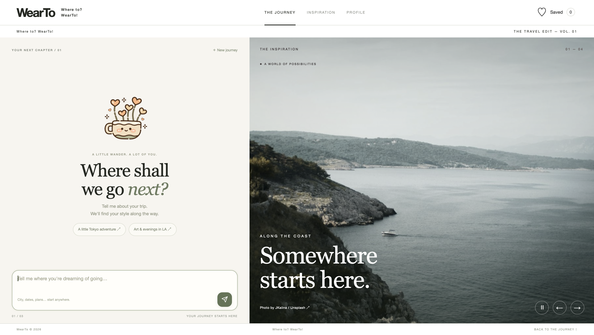

# WearTo — Where to? WearTo!

**Intelligent Travel Style & Shopping Assistant · Group 17**

This repository follows the seven-section [Workshop Project Submission Template](https://github.com/IRS-PM/Workshop-Project-Submission-Template). The application code is in [SystemCode/clips](SystemCode/clips/), and the complete setup instructions are in the [WearTo runbook](SystemCode/clips/docs/wearto-runbook.md). The repository currently uses the submission identifier `IRS-PM-2026-10-25-AIS08FT-GRP17-WearTo`.

---

## SECTION 1: WearTo — Where to? WearTo!

An intelligent travel style and shopping assistant.

---

## SECTION 2: EXECUTIVE SUMMARY / PAPER ABSTRACT

Choosing what to wear for a trip means balancing destination weather, planned activities, personal style, budget, social inspiration, products available to buy, and clothes already owned. WearTo brings these inputs into a multi-turn conversation. A traveller describes a trip, answers follow-up questions when details are missing, reviews the interpreted requirements, and can keep chatting to refine the recommended outfits.

The current local prototype uses Qwen to understand trip requirements and combines them with weather and knowledge-based context. It retrieves visual inspiration from Unsplash and encodes images with FashionCLIP. For purchasable clothing, it performs hybrid image and keyword searches through eBay Production, then reranks candidates against the trip context and social references to produce category-level Top-K results. The user's wardrobe remains separate from the eBay Top-K pool. An outfit compatibility module combines items from both pools and scores the combinations; the recommendation module applies constraints and presents up to three outfits. After confirming an outfit, the user can request an AI-generated preview. Intermediate files and module outputs are retained locally for inspection and handoff.

The website is currently a local, single-user prototype. Live runs require separately configured API credentials, model files, and an enabled eBay Production keyset. Product availability reflects the API evidence at retrieval time; final purchase availability must be checked on the seller's page.

---

## SECTION 3: CREDITS / PROJECT CONTRIBUTION

The keywords below summarize primary contributions evident in this repository's commits. Shared integration work is not attributed exclusively to one person.

| Team member | Student ID | Main contribution keywords |
| --- | --- | --- |
| [Agarwal Hritik Kumar](https://github.com/MasterHrit) | A0353874R | Unsplash inspiration; FashionCLIP image encoding; reference-image retrieval and ranking; module handoff; offline evaluation |
| [Jiang Yushan](https://github.com/caiji666) | A0353592X | Multi-turn trip dialogue; Qwen requirement extraction; weather and knowledge reasoning; activity knowledge graph; chat interface |
| [Lu Yujing](https://github.com/Tang-chu) | A0351286B | AI-assisted outfit recommendation and Top-3 ranking; multi-turn recommendation refinement and confirmation; selective pipeline re-execution; generative-AI outfit preview; module and full-pipeline testing |
| [Ma Bofei](https://github.com/Bofei2058) | A0314662H | Outfit compatibility model; combination generation and scoring; product-information output |
| [Zhang Yurun](https://github.com/yurunzzz) | A0330891A | Hybrid eBay retrieval; product Top-K reranking; wardrobe image understanding; Production notification service; end-to-end integration; product-retrieval evaluation |

The [group report](ProjectReport/IRS-PM-2026-10-25-AIS08FT-GRP17-WearTo-Report.pdf) includes implementation and validation results.

---

## SECTION 4: VIDEO OF SYSTEM MODELLING & USE CASE DEMO

The final submission videos are available in [Video](Video/). Published YouTube links are listed below.

| Video | Repository file | YouTube link |
| --- | --- | --- |
| Product promotion and use-case demo | [WearTo_Promotion Video.mov](Video/WearTo_Promotion%20Video.mov) | [Watch on YouTube](https://www.youtube.com/watch?v=A9T1dum7yM0) |
| System design and technical walkthrough | [WearTo_System Design Video.mp4](Video/WearTo_System%20Design%20Video.mp4) | [Watch on YouTube](https://youtu.be/WjWHpptENcc) |

The videos are stored with Git LFS. Install Git LFS before cloning the repository. If a checkout contains only video pointer files, run git lfs pull from the repository root.

---

## SECTION 5: USER GUIDE

See the [WearTo runbook](SystemCode/clips/docs/wearto-runbook.md) for dependency installation, credentials, model setup, the full workflow, and website instructions. Run application commands from SystemCode/clips. For an **already configured** checkout:

~~~bash
cd SystemCode/clips
.venv/bin/python -m travel_agent.web --port 8765
~~~

Open <http://127.0.0.1:8765/>. A fresh clone requires the setup steps in the runbook. Private API credentials, downloaded model weights, and personal wardrobe photos are not included in this repository. The [product-retrieval runbook](SystemCode/clips/docs/product-retrieval-runbook.md) and [outfit integration guide](SystemCode/clips/docs/outfit-integration.md) describe the module interfaces.

---

## SECTION 6: PROJECT REPORT / PAPER

The [final group report](ProjectReport/IRS-PM-2026-10-25-AIS08FT-GRP17-WearTo-Report.pdf) (55 pages) covers the business problem, market research, system design, implementation, experiments, findings and future work. Appendices A–C contain the project proposal, course mapping and installation/user guide. Current technical documentation and offline evaluation code are in [SystemCode/clips/docs](SystemCode/clips/docs/) and [SystemCode/clips/evaluation](SystemCode/clips/evaluation/).

---

## SECTION 7: MISCELLANEOUS

Supplementary submission materials, if applicable, will be placed in [Miscellaneous](Miscellaneous/). Application source code, tests, and reproducible evaluation scripts are in [SystemCode/clips](SystemCode/clips/).
